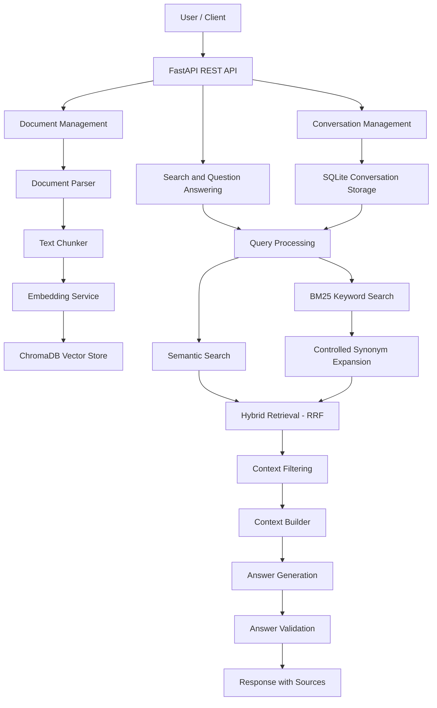

# Enterprise AI Knowledge Intelligence Platform

An AI-powered knowledge retrieval system that transforms unstructured documents into searchable, conversational knowledge.

The platform combines semantic search, BM25 keyword retrieval, hybrid ranking, and Retrieval-Augmented Generation (RAG) to help users retrieve relevant information from uploaded documents and interact with it through conversational queries.

**Built with:** Python · FastAPI · ChromaDB · Sentence Transformers · BM25 · Ollama

---

## Overview

Organizations accumulate large amounts of information in documents, policies, reports, and internal knowledge bases. Finding accurate information across these sources can be difficult and time-consuming.

This project explores how an AI-powered knowledge retrieval system can address that problem.

Users can upload documents, search their contents using natural language, and ask questions through a conversational interface. The backend retrieves relevant document passages and uses them to construct context-grounded answers.

## Key Features

### Document Processing
- Document upload and management through REST APIs.
- PDF and DOCX document parsing.
- Text chunking with metadata preservation.
- Embedding generation using Sentence Transformers.
- Persistent vector storage using ChromaDB.

### Intelligent Retrieval
- Semantic search using vector embeddings.
- BM25 keyword retrieval.
- Hybrid retrieval combining semantic and lexical rankings.
- Reciprocal Rank Fusion (RRF) with configurable ranking parameters.
- Controlled synonym expansion for BM25 keyword retrieval.
- Context filtering to reduce irrelevant retrieved content.
- Retrieval diagnostics for inspecting semantic, keyword, and fused rankings.

### Conversational RAG
- Question answering using retrieved document context.
- Conversation creation and history management.
- Context-aware follow-up question rewriting.
- Extractive answering before LLM generation.
- Ollama integration for language model responses.

### Answer Validation
- Lexical grounding checks against retrieved context.
- Empty and unsupported answer detection.
- Prompt leakage detection.
- Fallback mechanisms when LLM responses are unavailable or invalid.

**Note:** Answer validation currently uses heuristic and lexical checks. It is not a complete semantic fact-verification system.

---

## Architecture



### Retrieval and Answer Generation Flow

1. A user uploads a document.
2. The document parser extracts its text.
3. The text chunker divides the content into manageable passages.
4. Sentence Transformers generates vector embeddings.
5. ChromaDB stores the embeddings and associated metadata.
6. A user submits a natural-language question.
7. Semantic and BM25 keyword retrieval identify relevant passages.
8. Controlled synonym expansion improves keyword matching for selected terms.
9. Reciprocal Rank Fusion combines the retrieval rankings.
10. Context filtering selects relevant information.
11. The answer service constructs a response using document context.
12. Answer validation checks the response before returning it.

---

## Technology Stack

| Component | Technology |
|---|---|
| Programming Language | Python |
| Backend Framework | FastAPI |
| API Server | Uvicorn |
| Vector Database | ChromaDB |
| Embedding Model | Sentence Transformers |
| Embedding Architecture | all-MiniLM-L6-v2 |
| Keyword Retrieval | BM25 (rank-bm25) |
| Hybrid Ranking | Reciprocal Rank Fusion |
| Query Processing | Controlled synonym expansion |
| Language Model Runtime | Ollama |
| Language Model | Llama 3.2 1B |
| Conversation Storage | SQLite |
| Document Parsing | pypdf, python-docx |
| Testing | pytest |

---

## Retrieval Evaluation and Experiments

Retrieval quality is evaluated using a dedicated evaluation dataset and an isolated ChromaDB collection.

The evaluation collection, `enterprise_evaluation`, is separated from the production collection, `enterprise_knowledge`.

This separation allows retrieval experiments to run without modifying production knowledge records.

### Evaluation Components

- Multiple retrieval question datasets (V1–V4).
- Precision@K, calculated as relevant results in the top K divided by K, even when fewer than K results are returned.
- Recall@K.
- Mean Reciprocal Rank (MRR).
- Normalized Discounted Cumulative Gain (NDCG).
- Duplicate retrieval rate.
- Retrieval latency measurements.
- Question-level retrieval diagnostics.

### Hybrid Retrieval Experiments

Experiments compared:

1. Baseline hybrid retrieval using RRF K=40.
2. Hybrid retrieval with controlled BM25 synonym expansion using RRF K=40.
3. Baseline hybrid retrieval using RRF K=60.

### V4 Benchmark Results

| Metric | Baseline K=40 | Expanded K=40 | Baseline K=60 |
|---|---:|---:|---:|
| Precision@5 | 0.2760 | 0.2840 | 0.2720 |
| Recall@5 | 0.9700 | 0.9867 | 0.9633 |
| MRR | 0.8857 | 0.9033 | 0.8857 |
| NDCG@5 | 0.8898 | 0.9112 | 0.8856 |
| Duplicate Rate | 0 | 0 | 0 |

**Experiment observations:**

- Controlled synonym expansion improved all four retrieval quality metrics in this V4 experiment.
- Three questions improved, 47 remained unchanged, and none regressed under the experiment's question-level classification.
- RRF K=40 performed better than K=60 on the aggregate V4 metrics.
- These results apply to the current evaluation dataset and do not guarantee improvements for every possible query.

The current production configuration uses RRF K=40 with controlled BM25 synonym expansion enabled.

---

## Project Structure

```text
enterprise-ai-knowledge-platform/
│
├── backend/
│   │
│   ├── app/
│   │   ├── api/
│   │   │   └── routes/
│   │   │       ├── ask.py
│   │   │       ├── conversations.py
│   │   │       ├── documents.py
│   │   │       ├── health.py
│   │   │       └── search.py
│   │   │
│   │   ├── core/
│   │   │   └── config.py
│   │   │
│   │   ├── services/
│   │   │   ├── answer_service.py
│   │   │   ├── answer_validator.py
│   │   │   ├── context_builder.py
│   │   │   ├── context_filter.py
│   │   │   ├── conversation_service.py
│   │   │   ├── document_parser.py
│   │   │   ├── embedding_service.py
│   │   │   ├── hybrid_search.py
│   │   │   ├── keyword_search.py
│   │   │   ├── query_expansion.py
│   │   │   ├── llm_service.py
│   │   │   ├── prompt_builder.py
│   │   │   ├── query_rewriter.py
│   │   │   ├── rag_service.py
│   │   │   ├── text_chunker.py
│   │   │   └── vector_store.py
│   │   │
│   │   └── main.py
│   │
│   ├── evaluation/
│   │   ├── corpus/
│   │   ├── dataset/
│   │   ├── reports/
│   │   ├── build_evaluation_collection.py
│   │   ├── diagnose_retrieval.py
│   │   ├── evaluator.py
│   │   ├── experiment_bm25_expansion.py
│   │   └── experiment_hybrid_bm25_expansion.py
│   │
│   ├── tests/
│   ├── requirements.txt
│   └── requirements-dev.txt
│
├── .gitignore
└── README.md
```

---

## Getting Started

### Prerequisites

- Python 3.14.
- Git.
- Ollama.
- Sufficient memory and storage for the embedding model and vector database.

### 1. Clone the repository

```bash
git clone https://github.com/Mohitttttt/enterprise-ai-knowledge-platform.git

cd enterprise-ai-knowledge-platform
```

### 2. Create a virtual environment

```bash
cd backend

python -m venv .venv
```

Activate it on Windows PowerShell:

```powershell
.venv\Scripts\Activate.ps1
```

### 3. Install dependencies

```bash
python -m pip install -r requirements-dev.txt
```

### 4. Set up Ollama

Install Ollama and download the configured language model:

```bash
ollama pull llama3.2:1b
```

Ensure the Ollama service is running before making LLM-powered requests.

### 5. Start the API server

From the `backend` directory:

```bash
python -m uvicorn app.main:app --reload
```

The API will be available at:

```text
http://127.0.0.1:8000
```

### 6. Explore API documentation

- Swagger UI: http://127.0.0.1:8000/docs
- ReDoc: http://127.0.0.1:8000/redoc

---

## Evaluation

Run evaluation from the repository root.

Set the backend Python path:

```powershell
$env:PYTHONPATH = "$PWD\backend"
```

Run the V3 retrieval evaluation:

```powershell
python backend/evaluation/evaluator.py --dataset v3 --top-k 5 --rrf-k 40
```

The evaluator uses the isolated `enterprise_evaluation` collection by default.

To explicitly select a collection:

```powershell
python backend/evaluation/evaluator.py --dataset v3 --top-k 5 --rrf-k 40 --collection enterprise_evaluation
```

Evaluation reports are stored under:

```text
backend/evaluation/reports/
```

The experimental scripts can be used to investigate BM25 synonym expansion and hybrid retrieval configurations.

---

## API Endpoints

| Method | Endpoint | Description |
|---|---|---|
| GET | `/` | Root endpoint |
| GET | `/health` | Health check |
| POST | `/api/v1/documents/upload` | Upload a document |
| GET | `/api/v1/documents/` | List documents |
| GET | `/api/v1/documents/{document_id}` | Retrieve document details |
| DELETE | `/api/v1/documents/{document_id}` | Delete a document |
| POST | `/api/v1/search/` | Search document knowledge |
| POST | `/api/v1/ask` | Ask a question |
| POST | `/api/v1/conversations` | Create a conversation |
| POST | `/api/v1/conversations/{conversation_id}/messages` | Send a conversational message |
| GET | `/api/v1/conversations/{conversation_id}` | Retrieve conversation history |
| DELETE | `/api/v1/conversations/{conversation_id}` | Delete a conversation |

---

## Testing

Run the complete backend test suite from the repository root:

```powershell
$env:PYTHONPATH = "$PWD\backend"
python -m pytest backend/tests -v
```

### Latest Recorded Test Result

- **143 tests passed.**
- 0 test failures.
- 1 third-party ChromaDB deprecation warning.

Test coverage includes:

- API endpoints.
- Document processing.
- Text chunking.
- Hybrid retrieval.
- BM25 keyword search.
- Query expansion.
- Context filtering.
- Query rewriting.
- Answer extraction.
- Answer validation.
- RAG service behaviour.
- Vector store operations.
- Evaluation functionality.

---

## Engineering Concepts Demonstrated

- Designing modular REST APIs using FastAPI.
- Building document ingestion and processing pipelines.
- Generating and storing vector embeddings.
- Implementing semantic and lexical information retrieval.
- Combining ranked retrieval results using Reciprocal Rank Fusion.
- Implementing controlled query expansion.
- Designing isolated retrieval evaluation environments.
- Measuring retrieval performance using information retrieval metrics.
- Diagnosing retrieval failures.
- Designing conversational RAG workflows.
- Managing conversation state with SQLite.
- Building context filtering and answer validation components.
- Writing automated unit and integration tests.

---

## Current Limitations

This project is actively evolving.

Current implementation limitations include:

- Answer grounding relies on lexical heuristics rather than a dedicated semantic verification model.
- The language model currently runs locally through Ollama.
- Retrieval quality depends on document quality, chunking, and retrieval configuration.
- Synonym expansion uses a manually curated vocabulary and is not a general-purpose query understanding system.
- Production authentication, authorization, and multi-tenant isolation are not yet implemented.
- A production frontend and deployment infrastructure are not yet included.

---

## Roadmap

### Completed
- [x] Implement document ingestion and processing.
- [x] Implement semantic retrieval.
- [x] Implement BM25 keyword retrieval.
- [x] Implement hybrid retrieval using RRF.
- [x] Add retrieval evaluation datasets and metrics.
- [x] Benchmark RRF configurations.
- [x] Evaluate controlled BM25 synonym expansion.
- [x] Add retrieval diagnostics.
- [x] Expand automated backend test coverage.

### In Progress / Planned
- [ ] Further improve retrieval accuracy and robustness.
- [ ] Improve semantic answer verification.
- [ ] Implement authentication and authorization.
- [ ] Add document-level access control.
- [ ] Add advanced reranking.
- [ ] Add structured observability and logging.
- [ ] Build a modern web frontend.
- [ ] Add Docker-based deployment.
- [ ] Add CI/CD using GitHub Actions.

---

## Author

**Mohit Kumar Singh**

MSc Computer Science | Karlsruhe Institute of Technology (KIT)

GitHub: [@Mohitttttt](https://github.com/Mohitttttt)

---

*This project is developed as an ongoing exploration of enterprise knowledge retrieval, AI engineering, backend systems, and Retrieval-Augmented Generation.*
