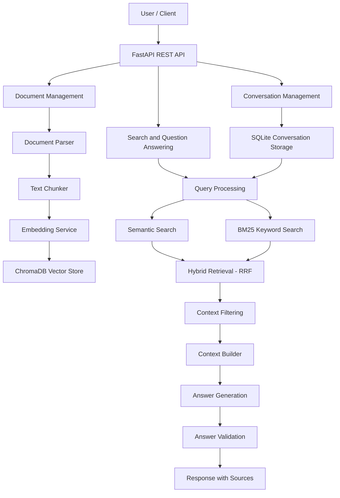

# Enterprise AI Knowledge Intelligence Platform

An AI-powered knowledge retrieval system that transforms unstructured documents into searchable, conversational knowledge.

The platform combines semantic search, BM25 keyword retrieval, hybrid ranking, and Retrieval-Augmented Generation (RAG) to help users retrieve relevant information from uploaded documents and interact with it through conversational queries.

**Built with:** Python · FastAPI · ChromaDB · Sentence Transformers · BM25 · Ollama

---

## Overview

Organizations accumulate large amounts of information in documents, policies, reports, and internal knowledge bases. Finding accurate information across these sources can be difficult and time-consuming.

This project explores how an AI-powered knowledge retrieval system can address that problem.

Users can upload documents, search their contents using natural language, and ask questions through a conversational interface. The backend retrieves relevant document passages and uses them to construct context-grounded answers.

## Key Features

### Document Processing
- Document upload and management through REST APIs.
- PDF and DOCX document parsing.
- Text chunking with metadata preservation.
- Embedding generation using Sentence Transformers.
- Persistent vector storage using ChromaDB.

### Intelligent Retrieval
- Semantic search using vector embeddings.
- Keyword search using BM25.
- Hybrid retrieval combining semantic and lexical results.
- Reciprocal Rank Fusion (RRF) for combining rankings.
- Context filtering to reduce irrelevant retrieved content.

### Conversational RAG
- Question answering using retrieved document context.
- Conversation creation and history management.
- Context-aware follow-up question rewriting.
- Extractive answering before LLM generation.
- Ollama integration for language model responses.

### Answer Validation
- Lexical grounding checks against retrieved context.
- Empty and unsupported answer detection.
- Prompt leakage detection.
- Fallback mechanisms when LLM responses are unavailable or invalid.

**Note:** Answer validation currently uses heuristic and lexical checks. It is not a complete semantic fact-verification system.

---

## Architecture



### Retrieval and Answer Generation Flow

1. A user uploads a document.
2. The document parser extracts its text.
3. The text chunker divides the content into manageable passages.
4. Sentence Transformers generates vector embeddings.
5. ChromaDB stores the embeddings and associated metadata.
6. A user submits a natural-language question.
7. Semantic and BM25 keyword retrieval identify relevant passages.
8. Reciprocal Rank Fusion combines the retrieval rankings.
9. Context filtering selects relevant information.
10. The answer service constructs a response using document context.
11. Answer validation checks the response before returning it.

---

## Technology Stack

| Component | Technology |
|---|---|
| Programming Language | Python |
| Backend Framework | FastAPI |
| API Server | Uvicorn |
| Vector Database | ChromaDB |
| Embedding Model | Sentence Transformers |
| Embedding Architecture | all-MiniLM-L6-v2 |
| Keyword Retrieval | BM25 (rank-bm25) |
| Hybrid Ranking | Reciprocal Rank Fusion |
| Language Model Runtime | Ollama |
| Language Model | Llama 3.2 1B |
| Conversation Storage | SQLite |
| Document Parsing | pypdf, python-docx |
| Testing | pytest |

---

## Project Structure

```text
enterprise-ai-knowledge-platform/
│
├── backend/
│   │
│   ├── app/
│   │   ├── api/
│   │   │   └── routes/
│   │   │       ├── ask.py
│   │   │       ├── conversations.py
│   │   │       ├── documents.py
│   │   │       ├── health.py
│   │   │       └── search.py
│   │   │
│   │   ├── core/
│   │   │   └── config.py
│   │   │
│   │   ├── services/
│   │   │   ├── answer_service.py
│   │   │   ├── answer_validator.py
│   │   │   ├── context_builder.py
│   │   │   ├── context_filter.py
│   │   │   ├── conversation_service.py
│   │   │   ├── document_parser.py
│   │   │   ├── embedding_service.py
│   │   │   ├── hybrid_search.py
│   │   │   ├── keyword_search.py
│   │   │   ├── llm_service.py
│   │   │   ├── prompt_builder.py
│   │   │   ├── query_rewriter.py
│   │   │   ├── rag_service.py
│   │   │   ├── text_chunker.py
│   │   │   └── vector_store.py
│   │   │
│   │   └── main.py
│   │
│   ├── tests/
│   ├── requirements.txt
│   ├── requirements-dev.txt
│   └── test_company_policy.txt
│
├── .gitignore
└── README.md
```

---

## Getting Started

### Prerequisites

- Python 3.14 (the current development environment uses Python 3.14.7).
- Git.
- Ollama.
- Sufficient memory and storage for the embedding model and vector database.

### 1. Clone the repository

```bash
git clone https://github.com/Mohitttttt/enterprise-ai-knowledge-platform.git

cd enterprise-ai-knowledge-platform
```

### 2. Create a virtual environment

```bash
cd backend

python -m venv .venv
```

Activate it on Windows PowerShell:

```powershell
.venv\Scripts\Activate.ps1
```

### 3. Install dependencies

```bash
python -m pip install -r requirements-dev.txt
```

### 4. Set up Ollama

Install Ollama and download the configured language model:

```bash
ollama pull llama3.2:1b
```

Ensure the Ollama service is running before making LLM-powered requests.

### 5. Start the API server

From the `backend` directory:

```bash
python -m uvicorn app.main:app --reload
```

The API will be available at:

```text
http://127.0.0.1:8000
```

### 6. Explore API documentation

FastAPI automatically provides interactive API documentation:

- Swagger UI: http://127.0.0.1:8000/docs
- ReDoc: http://127.0.0.1:8000/redoc

---

## API Endpoints

| Method | Endpoint | Description |
|---|---|---|
| GET | `/` | Root endpoint |
| GET | `/health` | Health check |
| POST | `/api/v1/documents/upload` | Upload a document |
| GET | `/api/v1/documents/` | List documents |
| GET | `/api/v1/documents/{document_id}` | Retrieve document details |
| DELETE | `/api/v1/documents/{document_id}` | Delete a document |
| POST | `/api/v1/search/` | Search document knowledge |
| POST | `/api/v1/ask` | Ask a question |
| POST | `/api/v1/conversations` | Create a conversation |
| POST | `/api/v1/conversations/{conversation_id}/messages` | Send a conversational message |
| GET | `/api/v1/conversations/{conversation_id}` | Retrieve conversation history |
| DELETE | `/api/v1/conversations/{conversation_id}` | Delete a conversation |

---

## Testing

The project includes automated tests covering core backend functionality.

Run the complete test suite from the `backend` directory:

```bash
python -m pytest -v
```

**Latest recorded test result:**

- 80 tests passed.
- 0 test failures.
- 1 third-party ChromaDB deprecation warning.

Test coverage includes:

- API endpoints.
- Document processing.
- Text chunking.
- Hybrid retrieval.
- BM25 keyword search.
- Context filtering.
- Query rewriting.
- Answer extraction.
- Answer validation.
- RAG service behaviour.

---

## Engineering Concepts Demonstrated

This project brings together several practical AI and backend engineering concepts:

- Designing modular REST APIs using FastAPI.
- Building document ingestion and processing pipelines.
- Generating and storing vector embeddings.
- Implementing semantic and lexical information retrieval.
- Combining ranked retrieval results using Reciprocal Rank Fusion.
- Designing conversational RAG workflows.
- Managing conversation state with SQLite.
- Building context filtering and answer validation components.
- Writing automated unit and integration tests.

---

## Current Limitations

This project is actively evolving.

Current implementation limitations include:

- Answer grounding relies on lexical heuristics rather than a dedicated semantic verification model.
- The language model currently runs locally through Ollama.
- Retrieval quality depends on document quality, chunking, and retrieval configuration.
- Production authentication, authorization, and multi-tenant isolation are not yet implemented.
- A production frontend and deployment infrastructure are not yet included.

---

## Roadmap

Planned engineering improvements:

- [ ] Build a modern web frontend.
- [ ] Add document-level access control.
- [ ] Improve semantic answer verification.
- [ ] Implement advanced reranking.
- [ ] Add structured observability and logging.
- [ ] Add Docker-based deployment.
- [ ] Implement authentication and authorization.
- [ ] Add evaluation datasets and RAG quality metrics.
- [ ] Add CI/CD using GitHub Actions.
- [ ] Benchmark retrieval accuracy and response latency.

---

## Author

**Mohit Kumar Singh**

MSc Computer Science | Karlsruhe Institute of Technology (KIT)

GitHub: [@Mohitttttt](https://github.com/Mohitttttt)

---

*This project is developed as an ongoing exploration of enterprise knowledge retrieval, AI engineering, backend systems, and Retrieval-Augmented Generation.*